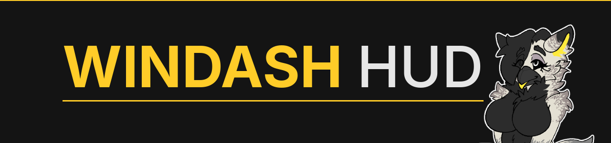
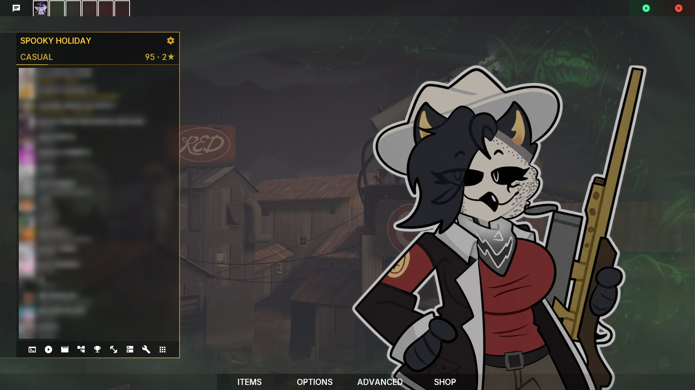
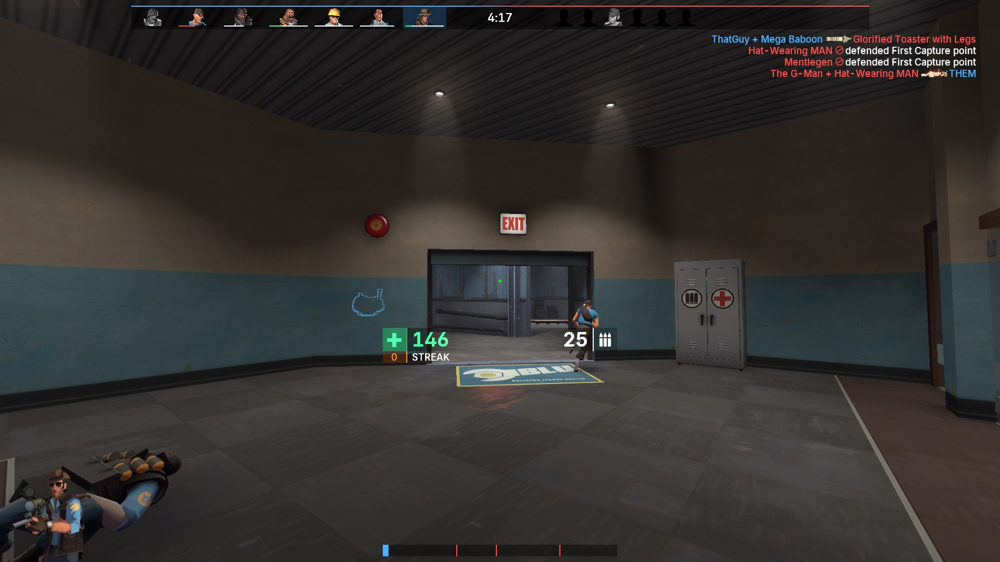
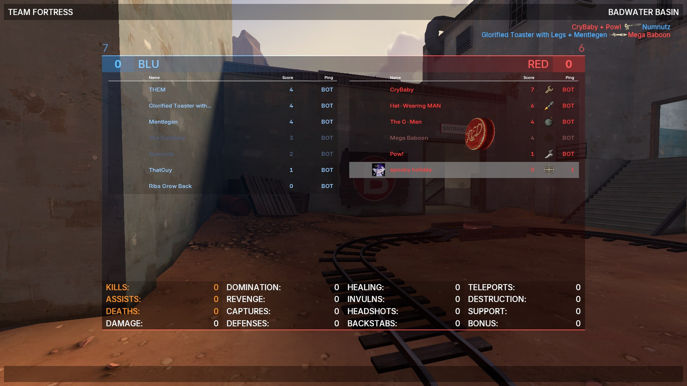
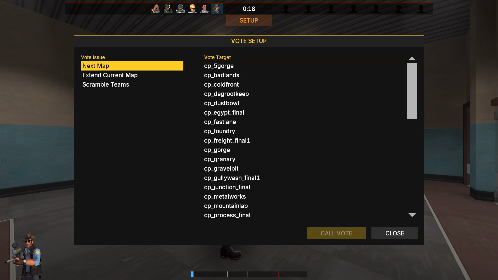
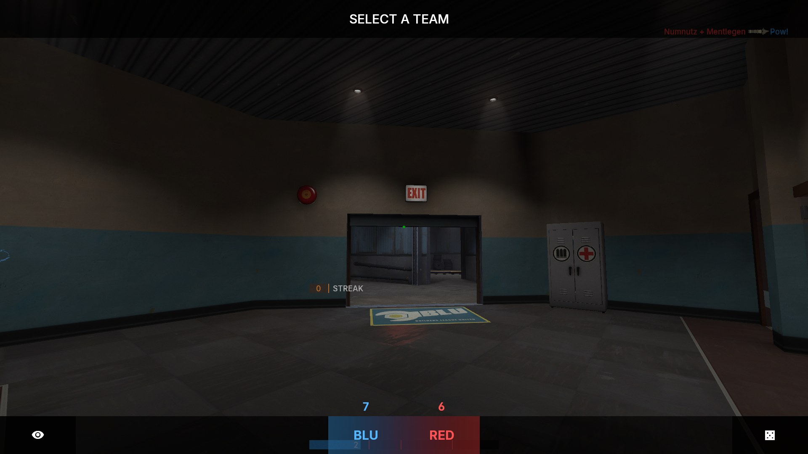
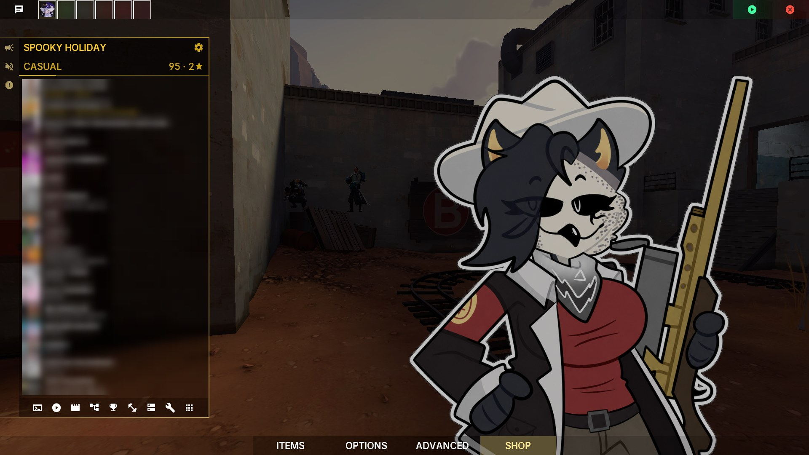
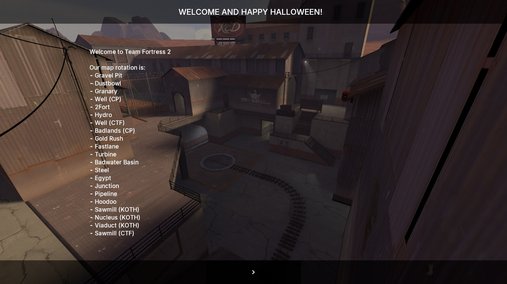

---

My TF2 HUD, built on top of [FRAGMENTHUD](https://github.com/leadscales/fragmenthud) 0.19.4 by [leadscales](https://github.com/leadscales) with lots of 🐦🐦🐦. All the credit for the base design goes to them. This version is recoloured gold on black and grey, with the config scripts and the customize menu taken out. Drop it in `custom/` and play, nothing to set up.

# Screenshots



|||
|:-:|:-:|
|||
|||
|||

# Install

Download the repo (**Code → Download ZIP**), extract it and move the folder into `tf/custom/`. The folder name doesn't matter. Take any other HUD out of `custom/` first.

```
tf/
├── cfg/
├── custom/
│   └── windashhud/
│       ├── base/
│       ├── frag/
│       ├── materials/
│       ├── resource/
│       ├── scripts/
│       └── info.vdf
└── ...
```

Nothing goes in `tf/cfg`. Restart the game after installing or updating, the main menu only reloads on a restart.

# Changes from FRAGMENTHUD

- Gold accents instead of blue. BLU team colours, item quality colours and the green/red status colours are unchanged.
- No `cfg/`, `dev/`, `extd/` or `user/`. No customize menu, first-run popup, link buttons or "Fix Issues" button.
- Main menu uses Fry BG (muted version) by [slumberditch](https://gamebanana.com/members/4714365) and my oc's art by [TheRabbitsito](https://x.com/TheRabbitsito) in place of the mercs, also during holidays.
- ConTracker colours from Full Halloween Theme, casual medals from Fixed Casual medals.
- Scoreboard shows the casual level badge next to the avatar.
- Party slots show a spinner while an invite is pending.
- Rank panel XP is a thin line under the panel.
- Vote menu (call vote dialog and the in-game vote panels) matches the rest of the HUD.
- Yellow hitmarker with a thin dark outline. It doesn't touch the crosshair.
- Target ID shows the Steam avatar left of the player name.
- Fixes: health panel off-screen on first load, overtime label pulsing every frame, stale/grey backdrop on the team and class menus.

# Notes

- The target ID avatar needs `tf_hud_target_id_show_avatars 1`. The default (2) only shows friends, and bots have no avatar.
- To pick which maps show on the menu, edit `scripts/chapterbackgrounds.txt` and keep the entries numbered in order.
- With more than 12 players on a team the scoreboard can scroll, and TF2 leaves the casual medals of rows scrolled off the top drawn above the list. That's a game bug the HUD can't clip. `tf_scoreboard_mouse_mode 2` (the default) resets the scroll every time the scoreboard opens.
- Made and tested at 1920×1080.

# Credits

- [leadscales](https://github.com/leadscales) for [FRAGMENTHUD](https://github.com/leadscales/fragmenthud). This HUD is their work with my changes on top, go give it a star.
- [TheRabbitsito](https://x.com/TheRabbitsito) for the character art on the main menu.
- slumberditch for [Fry BG - Stylish Backgrounds](https://gamebanana.com/mods/612873).
- Prof. Prostate for the ConTracker look from [Full Halloween Theme](https://gamebanana.com/mods/623876).
- AGoJyt for [Fixed Casual medals](https://gamebanana.com/mods/639303).
- Valve for everything in `base/`.

# License

See `license.txt`. FRAGMENTHUD files and my changes are LGPL-3.0-or-later, `base/` belongs to Valve, the fonts are OFL / Apache-2.0, and the bundled mods and the character art belong to their authors.
